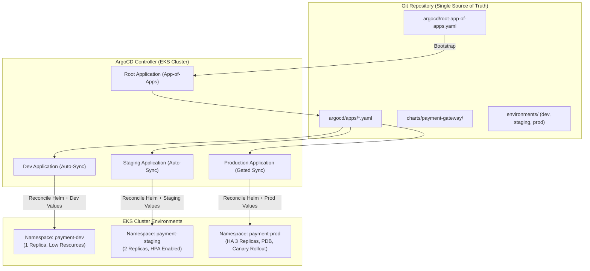

# Production GitOps Multi-Environment Delivery with ArgoCD, Helm & AWS EKS

[](#-gitops-pipeline-flow)
[](https://argoproj.github.io/cd/)
[](https://argoproj.github.io/argo-rollouts/)
[](https://helm.sh/)
[](https://kubernetes.io/)

A production-grade GitOps repository demonstrating **multi-environment continuous delivery** (`dev`, `staging`, `prod`) using **ArgoCD**, the **App-of-Apps architectural pattern**, **Helm 3** packaging, and **Argo Rollouts** for automated canary traffic shifting with Prometheus metric verification.

---

## 🏛️ GitOps Architecture: App-of-Apps Pattern



---

## 🚀 Key Features

1. **Declarative GitOps (ArgoCD):** Git is the sole source of truth. Every change committed to `main` is continuously reconciled by ArgoCD.
2. **App-of-Apps Pattern:** Manage all clusters, environments, and applications from a single root manifest (`root-app-of-apps.yaml`).
3. **Automated Drift Detection & Self-Healing:** Rogue manual changes in the cluster (e.g. `kubectl edit`) are automatically detected and overwritten to match Git state within minutes.
4. **Environment Value Hierarchies:**
   - **`dev`:** 1 pod, low footprint, automated rolling updates.
   - **`staging`:** 2 pods, HPA autoscaling, staging ingress.
   - **`prod`:** 3 base pods scaling to 10 via HPA, Pod Disruption Budget (`minAvailable: 2`), high-availability pod anti-affinity across Availability Zones, and TLS Ingress.
5. **Progressive Canary Delivery (Argo Rollouts):** Canary deployments with automated Prometheus analysis (`payment-success-rate-check`), shifting traffic in stages (`20% -> 50% -> 100%`) with automatic rollback on error spikes.

---

## 📁 Repository Structure

```text
├── .github/
│   └── workflows/
│       └── gitops-ci.yaml         # Helm linting, environment template validation, container testing
├── app/
│   ├── main.py                    # Cloud-native Payment Gateway microservice with /metrics
│   └── requirements.txt           # Production dependencies
├── docker/
│   └── Dockerfile                 # Hardened multi-stage build (non-root UID 10001)
├── docker-compose.yml             # Local testing environment
├── charts/
│   └── payment-gateway/           # Production Helm v3 Chart
│       ├── Chart.yaml             # Chart metadata
│       ├── values.yaml            # Base default configuration values
│       └── templates/             # Deployment, Service, HPA, Ingress, PDB, ServiceAccount
├── environments/
│   ├── dev/values.yaml            # Minimal footprint dev overlay
│   ├── staging/values.yaml        # Staging overlay with HPA
│   └── prod/values.yaml           # High-availability production overlay with PDB and Anti-Affinity
├── argocd/
│   ├── root-app-of-apps.yaml      # Master App-of-Apps controller
│   └── apps/                      # Declarative Application manifests for dev, staging, prod
├── rollouts/
│   ├── canary-rollout.yaml        # Argo Rollout canary specification (20% -> 50% -> 100%)
│   └── analysis-template.yaml     # Automated Prometheus success rate analysis
└── docs/
    ├── gitops-workflow.md         # Drift detection, self-healing, and App-of-Apps guide
    └── canary-rollouts-guide.md   # Progressive canary rollout instructions
```

---

## ⚡ Local Quickstart

### 1. Test Application Locally
```bash
docker compose up --build -d
curl http://localhost:8080/healthz
curl -X POST http://localhost:8080/v1/charge \
  -H "Content-Type: application/json" \
  -d '{"amount": 49.99, "currency": "USD", "customer_id": "cust_123", "card_token": "tok_visa"}'
```

### 2. Run Automated Tests
```bash
pip install -r app/requirements.txt
pytest tests/ -v
```

---

## ☸️ Bootstrapping GitOps on Kubernetes

1. **Install ArgoCD:**
   ```bash
   kubectl create namespace argocd
   kubectl apply -n argocd -f https://raw.githubusercontent.com/argoproj/argo-cd/stable/manifests/install.yaml
   ```

2. **Deploy the Root App-of-Apps:**
   ```bash
   kubectl apply -f argocd/root-app-of-apps.yaml
   ```
   *ArgoCD automatically detects and provisions all 3 environments (`payment-dev`, `payment-staging`, and `payment-prod`).*

3. **Access the ArgoCD Web UI:**
   ```bash
   kubectl port-forward svc/argocd-server -n argocd 8080:443
   ```
   Open `https://localhost:8080` in your browser.

---

## 📄 License
This project is open-source under the [MIT License](LICENSE).
