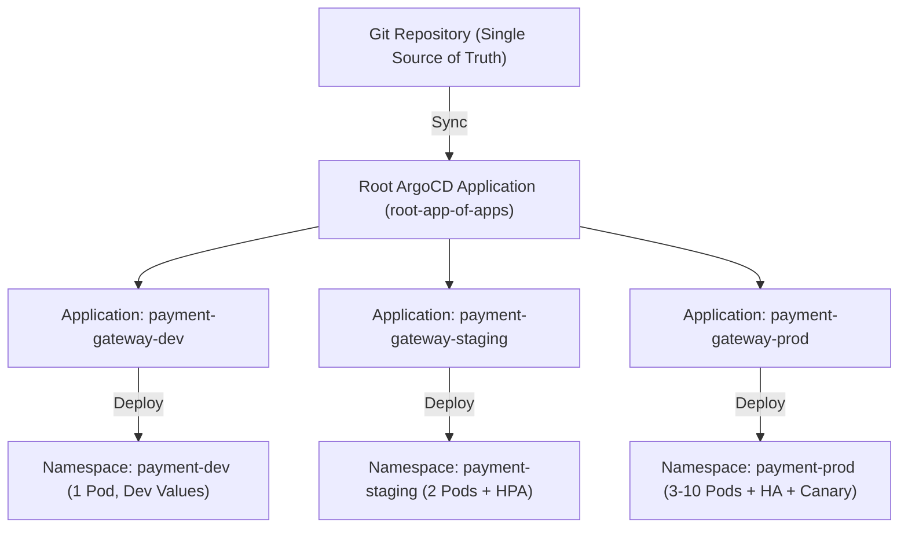

# GitOps Multi-Environment Architecture & Workflow

This document explains how ArgoCD uses the **App-of-Apps Pattern** to manage declarative multi-environment delivery.

---

## 1. App-of-Apps Hierarchy

---

## 2. Automated Drift Detection & Self-Healing

When an engineer or external actor attempts to manually modify a Kubernetes resource in the cluster:
1. **Drift Detection:** ArgoCD compares live state in the cluster against target state in Git every 3 minutes.
2. **OutOfSync State:** The application is marked as `OutOfSync`.
3. **Self-Healing:** Because `selfHeal: true` is configured, ArgoCD automatically overwrites the rogue change and restores the exact declarative configuration defined in Git.
